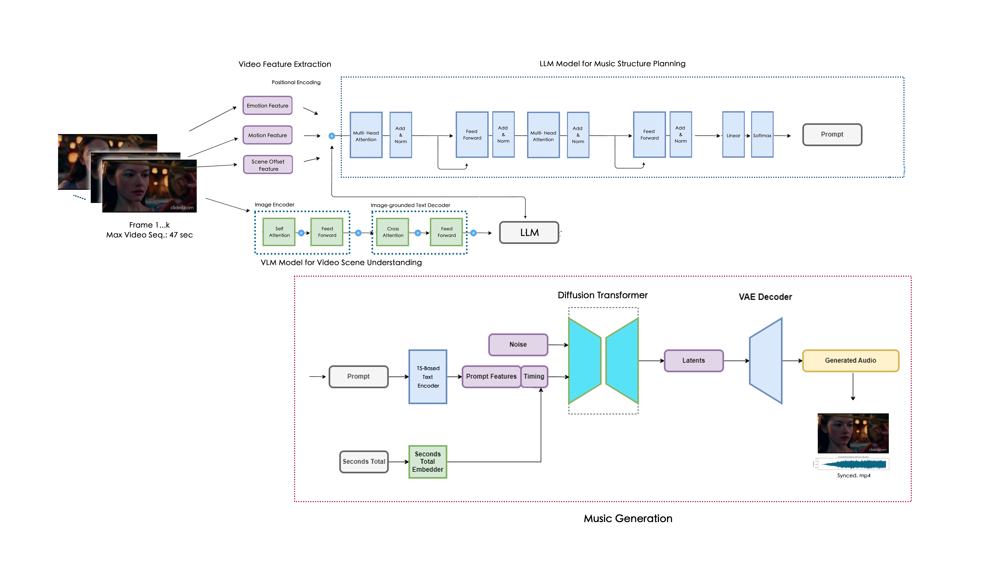
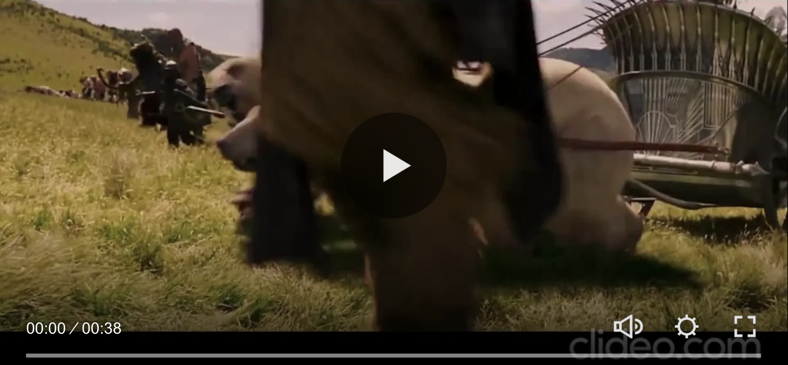
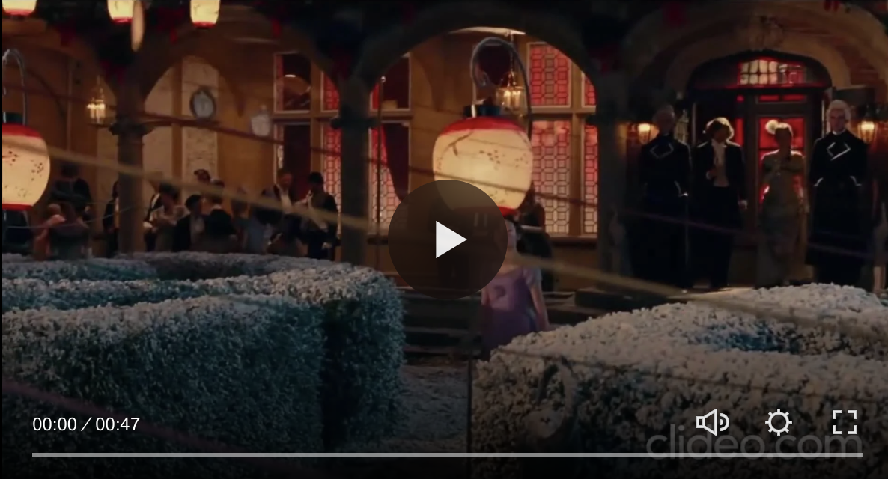
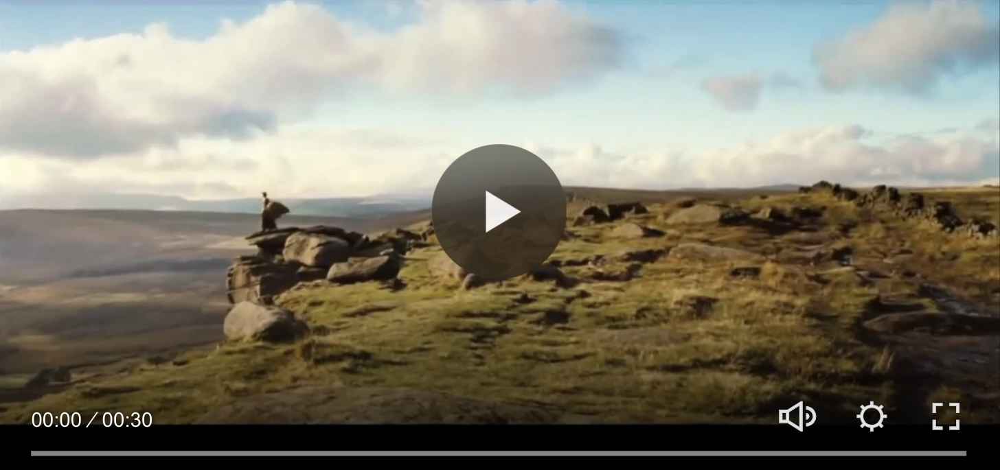

<div align="center">

# Multimodal Automatic Film Score Generation


[AI System](https://www.hsinminglobal.com/multimodal-automatic-film-score-generation) | [HSINMIN GLOBAL MUSIC Official Website](https://www.hsinminglobal.com/) | [Paper] | [FilmScore12 Demonstration](https://www.hsinminglobal.com/film-music) 
</div>


<p align="center">
  <a href="https://www.hsinminglobal.com/multimodal-automatic-film-score-generation">
    
  </a>
</p>

<h1 align="center">
  Multimodal Automatic Film Score Generation
</h1>


## Introduction
We propose a fully‐automated, four‐stage framework for film score generation that tightly couples multimodal video understanding with large‐language‐model‐driven planning and latent diffusion synthesis. We train and evaluate our system on the new FilmScore12 dataset of 418 paired video–music clips spanning 12 cinematic genres. Objective metrics (loudness, spectral coverage, dynamic contrast) and ablation studies confirm the importance of each feature modality, while a filmmaker user study rates 85 % of generated drafts as immediately useful. We utilize FilmScore12 and our full codebase to catalyze further research in emotion‐aware, context‐driven AI film scoring.





### Demo Video

The following demonstrations illustrate the application of multimodal AI to automatic film score generation.

#### Demo 1

<p align="center">
  <a href="https://www.hsinminglobal.com/multimodal-automatic-film-score-generation" target="_blank">
    
  </a>
</p>

#### Demo 2

<p align="center">
  <a href="https://www.hsinminglobal.com/multimodal-automatic-film-score-generation" target="_blank">
    
  </a>
</p>

#### Demo 3

<p align="center">
  <a href="https://www.hsinminglobal.com/multimodal-automatic-film-score-generation" target="_blank">
    
  </a>
</p>

<p align="center">
  <strong>
    <a href="https://www.hsinminglobal.com/multimodal-automatic-film-score-generation">
      View Full AI System Demonstrations
    </a>
  </strong>
</p>


## FilmScore12 Dataset


## Music Representation and Arrangement Examples

The following figures illustrate MIDI-based musical representations and multitrack composition workflows relevant to cinematic music structure and audiovisual synchronization.

<table>
  <tr>
    <td width="50%" align="center" valign="top">
      
      <p><strong>Figure 1. MIDI Note Representation</strong></p>
      <p><em>MIDI piano-roll visualization illustrating pitch, onset timing, duration, and polyphonic structure.</em></p>
    </td>
    <td width="50%" align="center" valign="top">
      
      <p><strong>Figure 2. Multitrack Music Arrangement</strong></p>
      <p><em>Digital audio workstation illustrating layered instrumentation, musical sections, and temporal organization.</em></p>
    </td>
  </tr>
</table>


### Overview

**FilmScore12** is a multimodal film–music dataset developed by **HSINMIN GLOBAL MUSIC** to advance research in automatic film score generation, emotion-aware music synthesis, and context-driven audiovisual intelligence.

The dataset consists of **418 paired video–music clips across 12 cinematic genres**, providing a research foundation for understanding the relationships between visual storytelling, emotional dynamics, cinematic context, and musical expression.

FilmScore12 supports the research presented in **Multimodal Automatic Film Score Generation**, integrating multimodal video understanding, large language model (LLM)-based music structure planning, and generative audio synthesis.

### Dataset Information

| Attribute | Description |
|-----------|-------------|
| Dataset Name | FilmScore12 |
| Dataset Size | 418 paired video–music clips |
| Cinematic Genres | 12 |
| Modalities | Video and Music |
| Research Area | Multimodal AI, Emotion Recognition, Generative Music |
| Primary Application | Automatic Film Score Generation |
| Research Organization | HSINMIN GLOBAL MUSIC |
| Associated Research | Multimodal Automatic Film Score Generation |

### Research Objectives

FilmScore12 is designed to support research in:

1. **Multimodal Video Understanding:** Analyzing visual scenes, emotional progression, and cinematic context.
2. **Emotion-Aware Music Generation:** Investigating relationships between visual emotions and musical characteristics.
3. **Context-Driven Film Scoring:** Supporting AI-generated soundtracks aligned with narrative and cinematic context.
4. **Audiovisual Synchronization:** Exploring temporal alignment between visual sequences and musical composition.
5. **Generative AI Evaluation:** Evaluating multimodal approaches to automatic film score generation.

### Dataset Demonstration

The official FilmScore12 audiovisual demonstration is available through the HSINMIN GLOBAL MUSIC research website.

**[View FilmScore12 Dataset Demonstration – Video with Audio](https://www.hsinminglobal.com/film-music)**


The demonstration presents audiovisual examples illustrating the relationship between cinematic scenes and musical expression.

### Research Applications

FilmScore12 provides a foundation for developing and evaluating AI systems that integrate visual, emotional, contextual, and musical information.

Potential applications include:

- Automatic film score generation
- Multimodal narrative understanding
- Emotion-aware soundtrack generation
- Context-sensitive audiovisual intelligence
- AI-assisted creative production

### Academic Research and Citation

FilmScore12 is associated with the research project **Multimodal Automatic Film Score Generation**.

**Research Repository:** [GitHub – Multimodal Automatic Film Score Generation](https://github.com/HsinMinChou/Multimodal-Automatic-Film-Score-Generation)

**Research Organization:** [HSINMIN GLOBAL MUSIC](https://www.hsinminglobal.com/)

Researchers wishing to cite FilmScore12 should refer to the associated research publication once its bibliographic information is available.

### Dataset Access and Licensing

The public demonstration provides audiovisual examples of FilmScore12. Availability of the complete dataset and permission to use or redistribute its contents should be confirmed separately.

The repository's MIT software license does not automatically extend to third-party audiovisual materials or dataset contents.


## Project Overview

This repository implements a complete backend service that:

1. **Analyzes video emotion**: Splits an uploaded video into frames and uses the CLIP model to extract probabilities for six emotions (exciting, fearful, tense, sad, relaxing, neutral) over time.
2. **Generates cinematic prompts**: Sends the emotion time-series to an OpenAI GPT-4o-mini-based responder which produces a structured music description prompt.
3. **Produces audio soundtrack**: Forwards the prompt to a local Gradio server via the `stable_audio_tools` package, generating a WAV-format film score.
4. **Merges audio and video**: Uses MoviePy to combine the original video (without its audio) and the generated soundtrack into a final MP4 file.
5. **Exposes API endpoints**: Provides `/upload` and `/generate` routes through a Flask application.
6. **Front-end tunneling**: Demonstrates how to expose these endpoints securely using a Cloudflare Tunnel (`cloudflare.exe`).

## Table of Contents

- [Prerequisites](#prerequisites)
- [Installation](#installation)
- [Architecture](#architecture)
  - [app.py](#apppy)
  - [openaitool.py](#openaitoolpy)
  - [video\_emotion\_helper.py](#video_emotion_helperpy)
  - [stable\_connect.py](#stable_connectpy)
  - [run\_gradio.py](#run_gradiopy)
- [API Endpoints](#api-endpoints)
- [Cloudflare Tunnel Setup](#cloudflare-tunnel-setup)
- [Usage Examples](#usage-examples)
- [Contributing](#contributing)
- [License](#license)

## Prerequisites

- **Operating System**: Linux, macOS, or Windows
- **Python**: Version 3.8 or higher
- **GPU**: CUDA-enabled GPU recommended for faster CLIP inference and audio model generation
- **ffmpeg**: Installed and accessible in your PATH for frame extraction and video/audio processing
- **Cloudflare Tunnel**: `cloudflare.exe` (or `cloudflared`) for securely exposing your local service

## Installation

1. Clone the repository:
   ```bash
   git clone https://github.com/HsinMinChou/AUTOMATIC-GENERATION-OF-FILM-SCORES-WITH-MULTIPLE-INSTRUMENTS.git
   cd AUTOMATIC-GENERATION-OF-FILM-SCORES-WITH-MULTIPLE-INSTRUMENTS
   ```
2. Create and activate a virtual environment:
   ```bash
   python3 -m venv venv
   source venv/bin/activate   # macOS/Linux
   venv\\Scripts\\activate  # Windows
   ```
3. Install dependencies:
   ```bash
   pip install -r requirements.txt
   ```
4. Set environment variables:
   - `OPENAI_API_KEY`: Your OpenAI API key
   - `GRADIO_USERNAME` and `GRADIO_PASSWORD` (optional): To protect the Gradio interface

## Architecture

Below is a detailed trace of each backend module, explaining key imports, classes, functions, and control flow:

### `app.py`

```python
import os
import shutil
from pathlib import Path
import cv2
import math

from flask import Flask, request, jsonify, send_from_directory
from flask_cors import CORS
from werkzeug.utils import secure_filename

from moviepy.editor import VideoFileClip, AudioFileClip

from video_emotion_helper import VideoEmotionFeatureExtractor
from openaitool import ChatGPTResponder
from stable_connect import StableAudioGenerator
```

- **Lines 1-7**: Standard library and third-party imports for filesystem operations, video processing (OpenCV, MoviePy), web server (Flask + CORS), and utility functions.
- **Lines 9-11**: Initialize Flask app and enable CORS to allow cross-origin requests from your front-end.
- **Lines 13-14**: Create `uploads/` and `outputs/` directories if they do not exist; these store incoming videos and generated outputs.
- **Line 16**: Define allowed video extensions (mp4, mov, avi).

```python
@app.route('/upload', methods=['POST'])
def upload_video():
    # 1. Validate file part and filename
    if 'video' not in request.files:
        return jsonify({'error': 'No file part'}), 400
    file = request.files['video']
    if file.filename == '':
        return jsonify({'error': 'No selected file'}), 400
    # 2. Check extension and save
    if file and allowed_file(file.filename):
        fname = secure_filename(file.filename)
        file.save(os.path.join(UPLOAD_FOLDER, fname))
        return jsonify({'status': 'success', 'filename': fname}), 200
    return jsonify({'error': 'Unsupported file type'}), 400
```

- **Lines 18-29**: `/upload` endpoint flow:
  1. Check for `video` field in form data.
  2. Ensure filename exists and has allowed extension.
  3. Sanitize filename to prevent path traversal.
  4. Save to `uploads/` and return JSON with the filename.

```python
@app.route('/generate', methods=['POST'])
def generate_music():
    data = request.get_json()
    # Validate JSON payload
    if not data or 'filename' not in data:
        return jsonify({'error': 'No filename provided'}), 400
    video_fn = data['filename']
    video_path = os.path.join(UPLOAD_FOLDER, video_fn)
    # Check file existence
    if not os.path.exists(video_path):
        return jsonify({'error': 'Video file not found'}), 404

    # 1. Calculate video duration
    cap = cv2.VideoCapture(video_path)
    fps = cap.get(cv2.CAP_PROP_FPS) or 30
    frame_count = cap.get(cv2.CAP_PROP_FRAME_COUNT) or 0
    duration_sec = math.ceil(frame_count / fps)
    cap.release()
    if duration_sec > 47:
        return jsonify({'error': f'Video too long ({duration_sec}s)'}), 400

    # 2. Extract emotion features
    extractor = VideoEmotionFeatureExtractor(video_path)
    txt_path = extractor.extract_emotion_feature()

    # 3. Generate music prompt via OpenAI
    responder = ChatGPTResponder()
    music_prompt = responder.get_response(txt_path)

    # 4. Generate WAV with StableAudioGenerator
    generator = StableAudioGenerator()
    base = Path(video_fn).stem
    wav_name = f"{base}_music.wav"
    wav_temp = generator.generate(
        prompt=music_prompt,
        file_naming=wav_name,
        seconds_total=duration_sec
    )
    # Move generated WAV to outputs/
    wav_path = Path(OUTPUT_FOLDER) / wav_name
    shutil.move(str(wav_temp), str(wav_path))

    # 5. Merge audio with original video
    video_clip = VideoFileClip(str(video_path)).without_audio()
    audio_clip = AudioFileClip(str(wav_path)).set_duration(video_clip.duration)
    final_clip = video_clip.set_audio(audio_clip)
    merged_name = f"{base}_with_music.mp4"
    merged_path = Path(OUTPUT_FOLDER) / merged_name
    final_clip.write_videofile(
        str(merged_path),
        codec="libx264",
        audio_codec="aac",
        temp_audiofile="temp-audio.m4a",
        remove_temp=True,
        threads=4
    )

    # Return final MP4 file as attachment
    return send_from_directory(
        directory=OUTPUT_FOLDER,
        path=merged_name,
        as_attachment=True,
        mimetype="video/mp4"
    )
```

- **Lines 31-74**: `/generate` endpoint flow:
  - **Validation**: JSON body and file existence.
  - **Step 1**: Duration check using OpenCV to enforce 47-second limit.
  - **Step 2**: Instantiate `VideoEmotionFeatureExtractor` to produce `<basename>.txt` emotion file.
  - **Step 3**: Use `ChatGPTResponder` to turn emotion data into a music prompt.
  - **Step 4**: Call `StableAudioGenerator.generate()` to obtain `.wav`, then move it to `outputs/`.
  - **Step 5**: Read video with MoviePy, remove original audio, attach generated audio, and write final MP4.
  - **Return**: Serve the merged video as a downloadable attachment.

### `openaitool.py`

```python
class ChatGPTResponder:
    def __init__(self, api_key: str = None):
        # 1. Load API key (hardcoded fallback or from ENV)
        openai.api_key = api_key or os.getenv("OPENAI_API_KEY")
        if not openai.api_key:
            raise ValueError("Please provide an OpenAI API key.")

    def get_response(self, input_text: str) -> str:
        # 2. Define constant system prompt for cinematic composition
        constant_prompt = (...)
        # 3. Call OpenAI ChatCompletion API
        response = openai.ChatCompletion.create(
            model="gpt-4o-mini",
            messages=[
                {"role": "system", "content": constant_prompt},
                {"role": "user", "content": input_text}
            ]
        )
        # 4. Extract and return the generated prompt
        return response.choices[0].message['content'].strip()
```

- **API Key Management**: Uses hardcoded fallback and environment variable, with error handling.
- **Prompt Engineering**: Embeds a detailed system prompt that instructs GPT to produce a structured output (Key, Genre, Mood, Tempo, Instruments).
- **OpenAI Call**: Synchronous request to `gpt-4o-mini`, returning plain text.

### `video_emotion_helper.py`

```python
class VideoEmotionFeatureExtractor:
    def __init__(self, video_path):
        self.video_path = Path(video_path)
        self.video_dir = self.video_path.parent
        self.video_base = self.video_path.stem

    def _split_video_into_frames(self, frame_dir):
        # Use ffmpeg to extract one frame per second
        cmd = f'ffmpeg -i "{self.video_path}" -vf "select=bitor(gte(t-prev_selected_t\,1),isnan(prev_selected_t))" -vsync 0 -qmin 1 -q:v 1 "{frame_dir}/%03d.jpg"'
        subprocess.call(cmd, shell=True)

    def extract_emotion_feature(self):
        # 1. Clear/create temp frames directory
        # 2. Call _split_video_into_frames()
        # 3. Load CLIP model and preprocess pipeline on GPU/CPU
        # 4. Tokenize emotion labels
        # 5. For each extracted frame:
        #    - Preprocess image
        #    - Run CLIP inference
        #    - Softmax to probabilities
        #    - Append "time prob1 prob2 ... prob6" to list
        # 6. Write header + all lines to `<video_base>.txt`
        # 7. Cleanup temp frames
        return result_str
```

- Splits into JPEG frames with ffmpeg, processes with CLIP ViT-L/14\@336px, outputs a time-stamped text file of emotion probabilities.

### `stable_connect.py`

```python
class StableAudioGenerator:
    def __init__(self, base_url: str = "http://127.0.0.1:7860/"):
        # 1. Initialize gradio_client.Client

    def generate(self, prompt: str, file_naming: str, seconds_total: int) -> Path:
        # 2. Build parameter dict matching Gradio API signature
        # 3. Call client.predict(api_name="/generate", **params)
        # 4. Rename default "output.wav" to `file_naming`
        # 5. Return Path to renamed WAV
```

- Wraps Gradio client to abstract file naming quirks and returns a filesystem `Path`.

### `run_gradio.py`

```python
def main(args):
    # 1. Set manual seed for reproducibility
    torch.manual_seed(42)

    # 2. Create Gradio interface using stable_audio_tools
    interface = create_ui(...)
    interface.queue()
    # 3. Launch server; if --share, returns a public link; supports basic auth
    interface.launch(share=args.share, auth=(args.username, args.password))
```

- Parses CLI args for model config, checkpoint paths, precision, and authentication.
- Launches a Gradio UI queue to handle multiple requests.

## API Endpoints

| Endpoint    | Method | Request Payload                       | Description                            |
| ----------- | ------ | ------------------------------------- | -------------------------------------- |
| `/upload`   | POST   | `video=@<file>` (multipart/form-data) | Uploads video to `uploads/`            |
| `/generate` | POST   | `{ "filename": "<video>.mp4" }`       | Generates and returns the scored video |

### Example: Upload video

```bash
curl -F "video=@sample.mp4" http://localhost:5000/upload
```

### Example: Generate scored video

```bash
curl -X POST -H "Content-Type: application/json" \
     -d '{"filename":"sample.mp4"}' \
     http://localhost:5000/generate --output sample_with_music.mp4
```

## Cloudflare Tunnel Setup

Expose your local Flask server securely:

```bash
cloudflare.exe tunnel --url http://localhost:5000 --name film-score-tunnel
```

After successful setup, note the generated `*.cfargotunnel.com` domain for front-end integration.

## Usage Example

1. **Start the Flask API**:
   ```bash
   python app.py
   ```
2. **Launch the Gradio music UI**:
   ```bash
   python run_gradio.py --ckpt-path ./models/checkpoint.pt --model-config ./configs/model.json
   ```
3. **Run Cloudflare Tunnel** (background or separate terminal).
4. **Upload video and generate scored video** via `curl` or your front-end.

## Contributing

Contributions are welcome! Please:

1. Fork the repository
2. Create a feature branch (`git checkout -b feature/YourFeature`)
3. Commit your changes (`git commit -m 'Add YourFeature'`)
4. Push to the branch (`git push origin feature/YourFeature`)
5. Open a Pull Request

## License

This project is licensed under the MIT License. See `LICENSE` for details.

